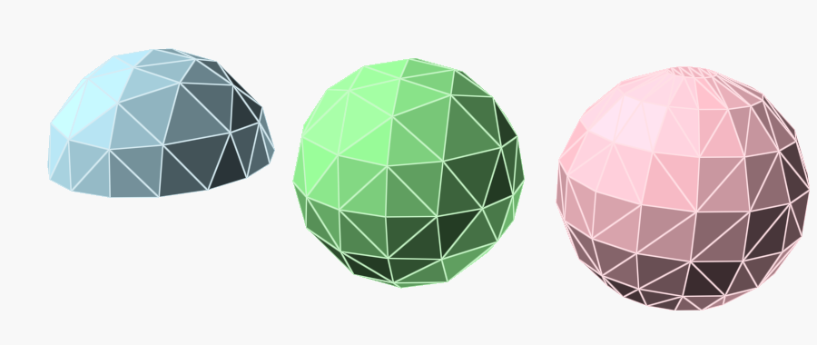

# octsphere-scad

`octsphere()` is a drop-in replacement for OpenSCAD's `sphere()` that builds a
geodesic sphere from a subdivided octahedron. Its triangles are spread evenly
over the surface instead of bunching at the poles, and its equators are
regular polygons lying flat in the XY, YZ and XZ planes, so it lines up with
cylinders, prisms and other polygon-based shapes. It can also make a
hemisphere with a flat base.



## Use it

```openscad
use <octsphere-scad/octsphere.scad>;

octsphere(r = 20);                     // like sphere(r = 20)
octsphere(d = 30);                     // or by diameter
octsphere(r = 20, hemisphere = true);  // upper half, flat base at z = 0

mesh = octsphere(r = 20);              // or get [points, faces]
polyhedron(points = mesh[0], faces = mesh[1]);
```

With no size it makes a sphere of radius 1, as `sphere()` does.

### Resolution

Resolution works as it does for `sphere()`: `$fn` if it's set, otherwise
`$fa` and `$fs`. The equator then snaps to the nearest count of the form
4 × 2ⁿ: 4, 8, 16, 32, 64, 128 and so on. At least 4 sides, the bare
octahedron. A sphere with an equator of 4 × 2ⁿ sides has 8 × 4ⁿ triangles.

| Settings, at r = 20 | Equator | Triangles |
| --- | --- | --- |
| defaults (`$fa = 12`, `$fs = 2`) | 32 | 512 |
| `$fn = 50` | 64 | 2048 |
| `$fa = 2`, `$fs = 0.5` | 128 | 8192 |
| `$fn = 3` or `4` | 4 | 8 |

`examples/compare.scad` draws a hemisphere, an octsphere and OpenSCAD's
`sphere()` side by side, as in the picture.

## Checks

`just test` takes under a second on OpenSCAD 2026.10.15. It renders seven
cases, from the defaults to a fine `$fa`/`$fs`, a diameter, a hemisphere and
no size at all. It checks each for one closed piece, its size, its triangle
count and that every vertex lies on the sphere. `just images` renders the
picture above.

## Origin and licence

`octsphere()` is Amatulic's
[Geodesic sphere with 3-axis polygon equators](https://www.thingiverse.com/thing:6481347)
(also on [Printables](https://www.printables.com/model/762498)), which builds
on Jamie Kawabata's
[Geodesic Sphere for OpenSCAD](https://www.thingiverse.com/thing:1484333).
Both are public domain under CC0. This copy adds the `$fa`/`$fs` fallback, so
it works without `$fn` set, plus the example and checks. MIT; see
[LICENSE](LICENSE).
